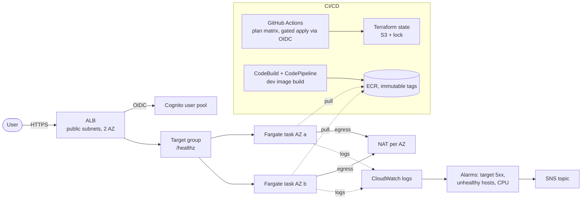

# aws-ecs-delivery-platform

Terraform for a containerised service on AWS: VPC with private subnets and NAT,
ECS Fargate behind an ALB with Cognito authentication, ECR, least-privilege IAM,
CodeBuild/CodePipeline, DEV/QA/PROD with image promotion, CloudWatch alarms,
and a tested zero-downtime cut-over and rollback.

**Status:** designed, built and verified in a personal AWS account, evidence in CI
and in the tables below. Not operated in production. Every apply is followed by a
destroy in the same session; total spend is capped at 30 EUR.

## Architecture

## Layout

| Path | What it holds |
|---|---|
| `bootstrap/state`, `bootstrap/github-oidc` | Remote state and the GitHub OIDC roles (plan read-only, apply gated) |
| `envs/shared` | Shared ECR repository |
| `envs/dev`, `envs/qa`, `envs/prod` | One root per environment; qa and prod promote the dev image by tag |
| `modules/network` | VPC, public and private subnets, NAT (`single` or `per_az`) |
| `modules/security` | ALB and task security groups |
| `modules/service` | ECS cluster and service, task definition, ALB, HTTPS listener, target group |
| `modules/auth` | Cognito user pool, client and domain for ALB authentication |
| `modules/pipeline` | CodeBuild and CodePipeline for the dev image |
| `modules/monitoring` | SNS topic, three alarms, dashboard (prod) |
| `scripts/cutover.sh` | Version cut-over and rollback by image tag |
| `docs/runbooks/` | [Go-live](docs/runbooks/go-live.md) and [cut-over and rollback](docs/runbooks/cutover.md) runbooks |

## Environments

| | dev | qa | prod |
|---|---|---|---|
| NAT | single | single | one per AZ |
| Tasks | 1 | 1 | 2, spread over 2 AZ |
| Image | built by CodePipeline | promoted dev tag | promoted qa tag |
| Apply gate | reviewer | reviewer | reviewer + 5 min wait |
| Alarms | no | no | yes |

## Delivery flow

1. Pull request: `validate` (fmt, validate, terraform test on the network module with a mocked provider, secret scan, workflow lint) and a `plan` job per root with the plan summary.
2. Merge to main: nothing is applied automatically.
3. `apply.yml` (manual dispatch, `env` and `action`): GitHub OIDC to a gated apply role, environment approval, then apply or destroy.
4. Releases: `scripts/cutover.sh <env> <tag>` registers a task definition with the new immutable tag and rolls the service (100/200, circuit breaker with rollback). Rollback is the same script with the previous tag. See [docs/runbooks/cutover.md](docs/runbooks/cutover.md).

## Evidence

| Test | What was verified | Result |
|---|---|---|
| A-010, qa promotion | qa runs the exact dev image | Same digest, healthz 200, follow-up plan clean, destroyed to zero |
| A-011, prod resilience | 2 tasks in 2 AZ, one task stopped under probe | 60/60 healthz 200 during the replacement |
| A-012, prod cut-over ([PR #19](../../pull/19)) | Version cut-over and rollback under a 2 s healthz probe | Cut-over 158 s, 83/83 200; rollback 174 s, 91/91 200; digests verified |
| A-013, prod alarms ([PR #20](../../pull/20)) | Health check broken on purpose, then restored | ALARM after ~4 min, OK ~4 min after restore, SNS action executed both ways |
| A-014, IAM boundary ([output](docs/evidence/A-014-boundary.txt)) | Deployed `app-boundary` evaluated with the IAM policy simulator against an allow-all identity policy (`scripts/simulate-boundary.sh`) | 9/9 as expected: ECS deploy and PassRole of `app/*-execution` to ecs-tasks allowed; PassRole to another service or role, CreateUser, AttachRolePolicy, prod state read, LeaveOrganization and AssumeRoleWithWebIdentity explicitly denied |
| A-015, Fargate ARM64 vs X86_64 ([x86 run 1](docs/evidence/A-015-x86-run1.json), [x86 run 2](docs/evidence/A-015-x86-run2.json), [arm64](docs/evidence/A-015-arm64.json), CPU: [1](docs/evidence/A-015-x86-run1-cpu.txt) [2](docs/evidence/A-015-x86-run2-cpu.txt) [3](docs/evidence/A-015-arm64-cpu.txt)) | Same commit and Dockerfile built for amd64 and arm64 (`cpu_architecture` variable); 300 rps for 5 min on `/healthz` through the ALB, 0.25 vCPU / 512 MB, CloudWatch task CPU | 0 errors in all runs; p50 24.1 / 24.1 / 24.0 ms, p99 29.1 / 31.8 / 26.4 ms (difference within network noise); task CPU ~23% x86 vs ~13.5% ARM, about 41% less. Capacity per dollar ~2x is derived from list price (~20% lower), not measured; minimal Rust app, other workloads will differ |
| A-016, EKS K2 ([output](docs/evidence/A-016-eks-healthz.txt), [manifest](k8s/delivery-app.yaml)) | Prod image by digest (`sha256:e585ab77`, same as A-010) on EKS 1.37, 1 t3.small managed node, Service type LoadBalancer; same hardening as ECS (uid 10001, read-only root fs, no capabilities); 60 `/healthz` probes from the internet, then destroy | 60/60 200, avg 0.102 s, one outlier at 3.1 s on a freshly created ELB, kept as measured; apply 9 min, Service deleted before destroy; ~25 min up, ~0.09 USD |

Every test ended with a destroy and a check of zero NAT, ALB, EIP, VPC and ECS
(and alarms and SNS for A-013).

## Security and trade-offs

- CI reaches AWS through GitHub OIDC only: a read-only `gha-plan` role for pull requests and a `gha-apply` role for protected environments, both trusted on the immutable owner and repo IDs.
- Every role CI creates must carry the `app-boundary` permissions boundary. It denies every IAM action except passing `app/*-execution` roles to ECS tasks (D-0114), and it denies account, Organizations, budget and state-bucket access.
- `gha-apply` uses `PowerUserAccess` plus scoped IAM and explicit deny guardrails. This is a deliberate choice for a single demo account; per-service policies are the next step.
- Container Insights is off to keep cost near zero; logs and ALB alarms (A-013) cover this demo.
- The app runs from a `scratch` image as user 10001 with a read-only root filesystem.

## Cost

| Item | Measured |
|---|---|
| prod running (2 NAT, ALB, 2 Fargate tasks) | ~0.16 USD per hour |
| One full prod test (apply, test, destroy) | ~0.4 to 0.5 h, ~0.07 USD |
| Project total so far | ~0.6 EUR of the 30 EUR cap |

CloudWatch alarms, dashboard and SNS stay within the free tier.

## Reproduce

Prerequisites: an AWS account, Terraform, and the `bootstrap/` roots applied once.

    terraform -chdir=envs/prod init
    terraform -chdir=envs/prod plan
    gh workflow run apply.yml -f env=prod -f action=apply
    scripts/cutover.sh prod <new_tag>
    gh workflow run apply.yml -f env=prod -f action=destroy

The TLS certificate is self-signed by default (no domain needed); `tls_mode = "acm_dns"` uses ACM with DNS validation when a domain exists.
